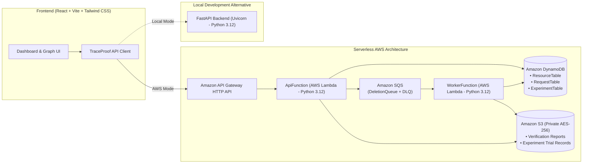

# TraceProof: Dependency-Aware Cloud Data Deletion Verification System

**Category:** Cloud Computing, Serverless Architecture, Data Privacy, Distributed Systems, Research Prototype  
**Status:** Complete Implementation & AWS Deployment Ready (No Unauthorized Cloud Resources Deployed)

---

## 1. Project Overview

Modern enterprise and cloud applications store information across interconnected, heterogeneous resources—primary databases, caching layers, derived analytics records, generated reports, and backup archives. When a deletion request is initiated, deleting only the primary root record does not guarantee that dependent records and derived artifacts are safely expunged.

**TraceProof** is a full-stack, research-oriented cloud verification system. It models registered cloud datasets as directed dependency graphs, simulates deletion workflows across both conventional (root-only) and dependency-aware traversal methods, and evaluates whether dependency awareness can systematically identify incomplete deletions across complex multi-tier dependencies.

> [!IMPORTANT]
> **Synthetic Research Invariant:** TraceProof is a synthetic research prototype. It strictly simulates deletion verification against registered resource metadata. It never invokes cloud destructive erasure primitives (such as DynamoDB `DeleteItem` or S3 `DeleteObject`) on real user data or live production resources.

---

## 2. Problem Statement

Conventional cloud deletion workflows frequently operate in silos:
1. A deletion request targets a root entity (e.g., `student_001` in a primary database).
2. The root entity is deleted or soft-deleted.
3. Downstream dependencies—such as derived aggregations, analytical datasets, query caches, and document exports in object storage—remain uninspected and unaddressed.
4. The system issues an unverified "Success" status, resulting in **silent incomplete deletion** (a high False Negative rate in compliance verification).

TraceProof addresses this by maintaining a dependency graph of registered data resources, traversing the closure upon deletion request, simulating deletion verification for every affected node, and generating verifiable audit reports detailing exact execution outcomes.

---

## 3. Key Features

- **Interactive Dynamic Lineage Graph:** Live visualization of registered cloud resources (DynamoDB tables, S3 objects, etc.), displaying directional prerequisites and dependent closures.
- **Dependency Closure Traversal:** Cycle-safe breadth-first traversal algorithm that resolves transitive dependencies while discarding duplicate relationships and preventing infinite loops.
- **Dual Verification Engine:**
  - *Baseline Method:* Deletes or observes only the primary root entity.
  - *TraceProof Method:* Identifies, attempts, and verifies the entire registered dependency closure.
- **Failure Scenario Simulation:** Injects simulated failures at various depths (root failure, child failure, grandchild failure, retry exhaustion, duplicate delivery).
- **Asynchronous Cloud Processing:** SQS job queue with DLQ redrive, Lambda worker execution, and DynamoDB transactional state updates.
- **Auditable Verification Reports:** Machine-readable JSON verification artifacts stored in private S3 storage, accessible via 5-minute presigned URLs or direct API retrieval.
- **Reproducible Statistical Experiment Engine:** Monte Carlo simulation runner evaluating 9 structural scenarios across configurable trials, density, and failure probabilities.
- **Comprehensive Research Metrics:** Automatic calculation of True Positives (TP), True Negatives (TN), False Positives (FP), False Negatives (FN), Recall/Detection Rate, False Negative Rate, False Positive Rate, Precision, F1 Score, Dependency Coverage, Simulated Retries, Mean/Median/Total Processing Latency, and Wilson 95% Confidence Intervals.
- **Statistical Significance Testing:** Paired two-sided exact McNemar binomial tests on discordant trial correctness.
- **Multi-Format Research Exports:** One-click downloads of `trials.csv` (trial records), `aggregates.csv` (summary metrics), and `report.md` (publication-ready Markdown report).
- **Dual Execution Modes:** Seamless switching between **LOCAL MODE** (FastAPI in-memory backend) and **AWS MODE** (API Gateway HTTP API, Lambda, DynamoDB, SQS, S3).

---

## 4. Architecture & Technology Stack



### Technology Stack
- **Frontend:** React 18, Vite, Tailwind CSS, Lucide React, HTML5 SVG Canvas.
- **Backend:** Python 3.12, FastAPI, Pydantic v2, Uvicorn.
- **AWS Services (5 Managed Families):**
  1. *Amazon API Gateway:* HTTP API with CORS configuration.
  2. *AWS Lambda:* Synchronous `ApiFunction` and asynchronous SQS-triggered `WorkerFunction`.
  3. *Amazon DynamoDB:* On-demand `ResourceTable`, `RequestTable`, and `ExperimentTable` (with TTL).
  4. *Amazon SQS:* `DeletionQueue` and `DeletionDeadLetterQueue` (with SSE and redrive policy).
  5. *Amazon S3:* Private AES-256 encrypted `ReportBucket` with 90-day lifecycle expiration.
- **Monitoring & Infrastructure:** Amazon CloudWatch Log Groups (14-day retention), AWS SAM (`template.yaml`).

---

## 5. Local Quickstart & Development

### Prerequisites
- Python 3.12+
- Node.js 18+ and npm

### Step 1: Start Backend (FastAPI Local Mode)
```powershell
cd backend
python -m venv .venv
.\.venv\Scripts\Activate.ps1
pip install -r requirements.txt
python -m uvicorn main:app --reload --port 8000
```
Backend health check is available at `http://localhost:8000/health`.

### Step 2: Start Frontend (Vite)
In a separate terminal:
```powershell
cd frontend
npm install
npm run dev
```
Open `http://localhost:5173` in your browser.

### Step 3: Run Tests
```powershell
# Run backend test suite (23 unit tests)
cd backend
.\.venv\Scripts\python.exe -m unittest discover -s tests -v

# Run frontend build
cd ../frontend
npm run build
```

---

## 6. Research Benchmark & Experiment Instructions

### Via the Web Dashboard
1. Navigate to the **Experiments** tab.
2. Select a preset (e.g., *Standard Benchmark*, *Deep Dependency Chain*, or *High Failure Stress*) or customize parameters:
   - *Resources Count:* 4 to 100
   - *Dependency Density:* 0.0 to 1.0
   - *Failure Probability:* 0.0 to 1.0
   - *Trials Per Scenario:* 1 to 100
   - *Random Seed:* Integer (for deterministic reproducibility)
   - *Dependency Depth:* 1 to N-1
3. Click **Execute Benchmark**.
4. Review the aggregate confusion matrices, precision, recall, F1 score, coverage, and exact McNemar test significance.
5. Export results via **trials.csv**, **aggregates.csv**, or **report.md**.

### Via API Command Line
```powershell
$body = '{"num_resources":12,"dependency_density":0.15,"failure_rate":0.2,"trials":5,"random_seed":42,"dependency_depth":4}'
$resp = Invoke-RestMethod -Method Post -Uri http://127.0.0.1:8000/experiments/run -ContentType 'application/json' -Body $body
$expId = $resp.experiment_id

# Download trial CSV
Invoke-WebRequest -Uri "http://127.0.0.1:8000/experiments/$expId/trials.csv" -OutFile "trials-$expId.csv"

# Download aggregate CSV
Invoke-WebRequest -Uri "http://127.0.0.1:8000/experiments/$expId/aggregates.csv" -OutFile "aggregates-$expId.csv"

# Download Markdown Report
Invoke-WebRequest -Uri "http://127.0.0.1:8000/experiments/$expId/report.md" -OutFile "report-$expId.md"
```

---

## 7. AWS Deployment Guide Summary

TraceProof is fully configured for serverless AWS deployment using AWS SAM.
For step-by-step instructions, permissions, and cost considerations, see [AWS_DEPLOYMENT.md](AWS_DEPLOYMENT.md).

```powershell
# Validate SAM template
sam validate --lint

# Build containerless arm64 artifacts
sam build

# Deploy to AWS (Requires explicit user confirmation)
sam deploy --guided
```

After deployment, copy the output `ApiBaseUrl` and update `frontend/.env.local`:
```dotenv
VITE_API_BASE_URL=https://<api-id>.execute-api.<region>.amazonaws.com
```

---

## 8. Dashboard Views & Architecture

- **System Overview:** Total registered assets, active deletion requests, verified vs incomplete count, verification success rate, live dependency graph preview, and baseline comparison.
- **Resource Lineage:** Full-scale interactive SVG dependency graph, resource directory with search & filter, upstream prerequisites, downstream dependents, and transitive closure inspector.
- **Deletion Requests:** Real-time log of asynchronous deletion requests with modal details drawer showing task execution states per target.
- **Verification Reports:** List of verifiable audit artifacts, interactive JSON viewer with clipboard export, and direct S3 presigned download links.
- **Research Experiment Runner:** Monte Carlo experimental harness with parameter presets, paired McNemar analysis, scenario breakdowns, and CSV/Markdown export.
- **Settings & Architecture:** Active mode diagnostic indicator (Local vs AWS), live API health ping, and AWS 5-service architectural breakdown.

---

## 9. Research Methodology & Limitations

Complete mathematical definitions, experimental protocols, Wilson score intervals, and threat analysis are documented in [RESEARCH_METHODOLOGY.md](RESEARCH_METHODOLOGY.md).

### Limitations
1. **Registered Closure Boundary:** TraceProof detects unaddressed data only among registered resources. Unregistered data copies, offline archives, and shadow datastores outside the graph model remain invisible.
2. **Simulation Model:** Execution timing reflects local Python or Lambda compute duration, not physical disk sanitization or media degaussing.
3. **No Claim of Physical Erasure:** Verification confirms that registered simulated deletion procedures returned success; it does not claim certified DoD 5220.22-M hardware erasure.
